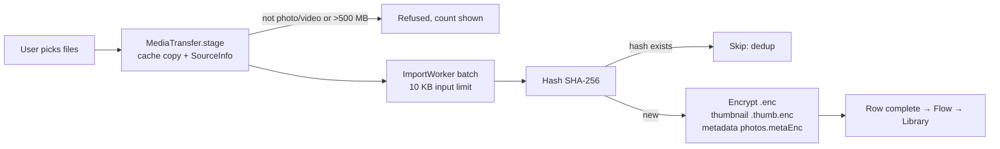
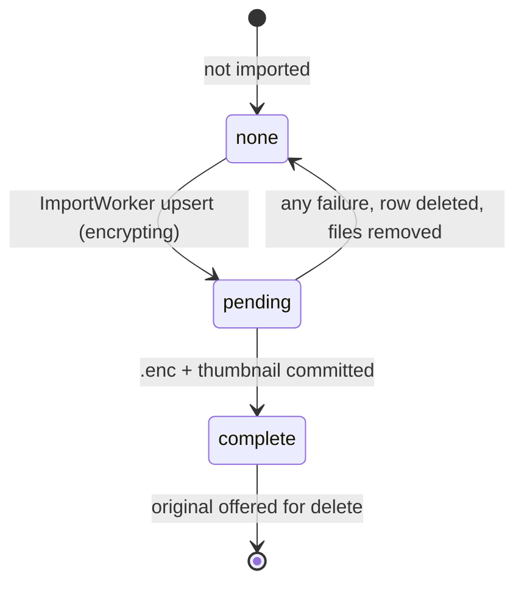
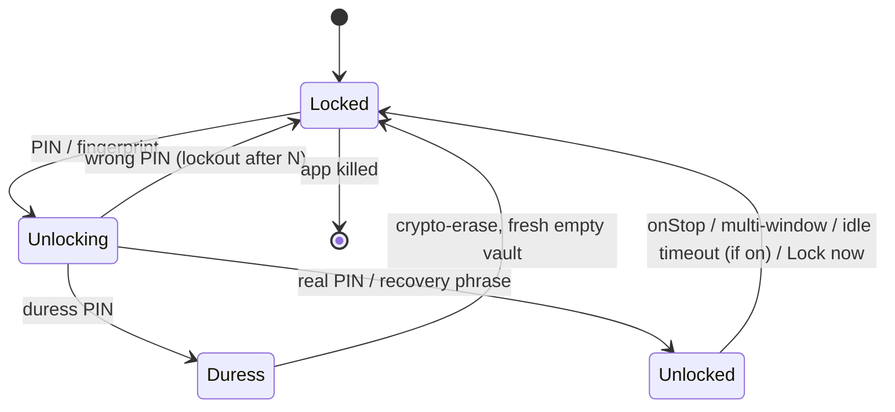
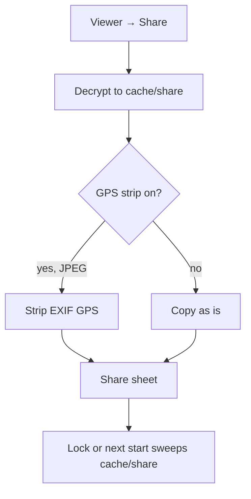
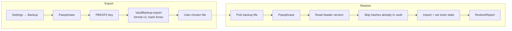
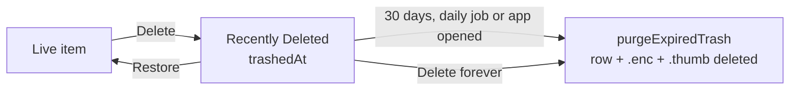

# Features, workflows and use cases

Map of what the app does, what runs **automatically** and what the user does **manually**, and what is still missing. Code paths are relative to `app/src/main/java/com/example/encryptedvault/`. Status is as of 2026-10-14.

## 1. Feature map

| Area | Feature | Where | Status |
|---|---|---|---|
| Unlock | PIN pad (6–12 digits), fingerprint via Keystore, 24-word recovery phrase | `crypto/KeyHierarchy.kt`, `crypto/Bip39.kt`, `ui/auth` | Done |
| Unlock | Save recovery phrase to a file (opt-in, setup screen only; phrase is never stored, so it cannot be saved later) | `ui/auth/AuthScreens.kt` `PhraseScreen`, `recoveryPhraseText` | Done (device run pending) |
| Unlock | Lockout after wrong PINs (monotonic clock) | `crypto/UnlockAttempts.kt` | Done (state verified; UI countdown not checked) |
| Unlock | Duress PIN: unlocks a fresh empty vault after crypto-erase | `crypto/KeyHierarchy.kt`, ADR-003 | Done |
| Privacy | `FLAG_SECURE`, lock on background, lock on multi-window | `MainActivity.kt`, `security/SessionManager.kt` | Done (split-screen not verified on device) |
| Privacy | Optional idle auto-lock (1/5/15 min, off by default) | `security/IdleLock.kt`, ADR-010 | Done |
| Privacy | Face-down lock (opt-in; accelerometer, app open only) | `security/FaceDown.kt`, `MainActivity.kt`, ADR-012 | Done (device run pending) |
| Settings | Status panel: vault state, auto-lock, face-down, fingerprint, key storage (hardware or software), vault size, free space | `ui/settings/SettingsScreen.kt`, `KeyHierarchy.wrapKeyInSecureHardware`, `SettingsStatus.kt` | Done (hardware check device run pending) |
| Unlock | Failed PIN log: last 20 wrong-PIN times, times only | `crypto/UnlockAttempts.kt`, Settings → Failed PIN attempts, ADR-012 | Done |
| Recovery | Recovery file re-check reminder every 90 days | `ui/settings/SettingsStatus.kt` `RecoveryReminder`, ADR-012 | Done |
| Import | Picker → stage → encrypt → thumbnail, dedup by content hash | `media/MediaTransfer.kt`, `work/ImportWorker.kt` | Done |
| Import | Size cap 500 MB; non-photo/video refused | `MediaTransfer.MAX_IMPORT_BYTES` | Done |
| Import | Auto-import new gallery photos and videos while the vault is open (opt-in, read permission, ADR-013) | `media/AutoImport.kt`, `MainActivity.kt` (`galleryObserver`), Settings → Privacy | Done (device run pending) |
| Library | Timeline grid, Select mode, filters, time range, sort | `ui/library/*`, `ui/library/Timeline.kt` | Done |
| Viewer | Zoom, swipe, video playback (segment decrypt), slideshow, info sheet | `ui/viewer/ViewerScreen.kt`, `media/VaultPlayer.kt` | Done |
| Edit | Rotate, flip, crop, 5 filters, brightness/contrast/saturation → new JPEG | `ui/viewer/EditScreen.kt`, `media/ImageEdits.kt` | Done (original never changed) |
| Edit | Trim video → new MP4 | `media/VideoTrim.kt` | Done (MP4 only tested) |
| For You | On This Day, Recently Added | `ui/foryou/*` | Done |
| Albums | Own albums, Favorites, Original Folders, Media Types, Hidden, Recently Deleted | `ui/albums/*`, `data/CollectionSource` | Done |
| Search | Name, caption, folder, type, year/month | `ui/search/*`, `SearchMatcher` | Done |
| Trash | 30-day Recently Deleted, purged daily in background and on app open | `work/TrashPurgeWorker.kt`, `data/VaultRepository.purgeExpiredTrash`, `ui/MainScaffold.kt` | Done (device run pending) |
| Restore | Restore to original gallery folder (fallback `Restored/<folder>`) | `media/MediaTransfer.restoreToGallery`, `media/RestoreTarget.kt` | Done |
| Share | Re-encrypt copy to cache, GPS strip toggle, temp swept on lock | `media/MediaTransfer.kt`, `MainActivity.lockNow` | Done (share flow not driven on device) |
| Backup | Encrypted single-file backup (PBKDF2, AES-GCM 1 MiB chunks, format v2) | `backup/VaultBackup.kt`, `crypto/BackupCrypto.kt` | Done |
| Backup | Password-protected zip (AES-256) wrapping the encrypted backup; move to another phone, restore with the same password (ADR-014) | `backup/ZipBackup.kt`, `ui/settings/BackupControls.kt` | Done (device run pending) |
| Export | Plain unencrypted export + `manifest.csv` (warns first) | `backup/PlainExport.kt`, ADR-008 | Done (HEIC/PNG location not stripped, gap G3) |
| Disguise | Launcher icon: Weather, Calculator, Notes, Clock | `appicon/AppIcon.kt` | Done (no fake app screen) |
| Storage | Room DB schema v5, migrations v1→v5 tested | `data/VaultDatabase.kt` | Done |
| Cache | Decrypted metadata cache, thumbnail decrypt cap 3 | `data/VaultRepository.kt`, `ui/common/ThumbnailLoader.kt` | Done |
| Hardware | StrongBox → TEE fallback | `crypto/KeyHierarchy.kt` | Done (emulator path only) |

## 2. Automatic vs manual

| Automatic (no user action) | Manual (user taps) |
|---|---|
| Encrypt, hash, dedup and thumbnail each imported file | Pick files to import (or turn on auto-import, which then copies new gallery items while the vault is open) |
| Resume an interrupted import batch after kill or reboot (WorkManager, APPEND chain `"import"`) | Choose whether to delete phone originals after import (prompted) |
| Lock vault when app leaves screen, goes multi-window, or config changes | Lock now (⋯ menu) |
| Lock after idle — **only if** enabled (default off) | Turn idle lock on (Settings → Privacy) |
| Sweep plaintext temp files on lock; sweep leftovers older than 10 min on start | Share, play, edit, trim (creates temp copies) |
| Drop decrypted metadata cache on lock | Restore an item to gallery |
| Purge trash older than 30 days: daily via WorkManager, and when the app UI opens | Empty trash / delete forever |
| Strip GPS from shared / plain-export JPEG copies **when the toggle is on** | Turn GPS strip on (Settings → Privacy) |
| Refresh Library when metadata changes (Flow) | Export encrypted backup / restore backup |
| Wipe on duress PIN entry (crypto-erase) | Set or remove duress PIN (needs real PIN) |
| Lock-out timer enforced across reboot | Plain export (must confirm warning) |

## 3. Use cases

| ID | Actor | Goal | Steps | Result |
|---|---|---|---|---|
| UC1 | User | Hide photos | Set up PIN → Import → Delete originals | Encrypted copies in vault; originals removed on confirm |
| UC2 | User | Bulk import 500 files | Import → app keeps running or is killed | Every file imported once; no orphan `.tmp` |
| UC3 | User | Edit a photo | Viewer → Edit → Save | New "(edited)" JPEG; original unchanged |
| UC4 | User | Share with GPS removed | Viewer → Share (strip on) | Shared copy without GPS; cache copy swept on lock |
| UC5 | User | Move to new phone | Settings → Backup → export → restore on new phone | Items with albums, captions, trash times |
| UC6 | User | Get a plain copy for another app | Settings → Backup → Export plain copies (accept warning) | Unencrypted files + `manifest.csv` |
| UC7 | User | Recover a deleted item | Albums → Recently Deleted → Restore | Back in original folder; within 30 days |
| UC8 | Bystander forces unlock | Protect data | Enter duress PIN | Empty vault; real data erased |
| UC9 | User loses PIN | Recover | Enter 24-word phrase | Vault unlocked; PIN reset |
| UC10 | User on shared phone | Auto-hide | Idle lock on 1 min; leave app | Lock screen after 1 min |
| UC11 | Attacker with adb | Extract data | `adb backup` | 0 bytes (`allowBackup=false`) |

## 4. Workflows

### 4.1 Import (automatic after pick)

Per-media state (vault row, keyed by content hash):

Deletion gate: an original is offered only when its hash has a `complete` row and the full GCM read of that copy succeeds (`MediaTransfer.verifiedOriginalUris`). A batch reporting SUCCEEDED does not mean every file imported; the count of failed files is reported (`ImportWorker.KEY_FAILED`).

### 4.2 Lock and unlock

### 4.3 Share and export

### 4.4 Backup and restore

### 4.5 Trash lifecycle

## 5. Gaps still open

| ID | Gap | Impact | Source | Needed |
|---|---|---|---|---|
| G1 | Not run on a real phone (Pixel 5 `15261FDD40022Q` now available) | Hardware-backed keys, split-screen, recents, share flow unverified | README, DESIGN_v5 #5–8 | Run `scripts/device-checks.sh` + manual checks on Pixel 5 |
| G2 | Intruder capture (ADR-009) not built; intruder log (times) is built | No photo on wrong PIN | ADR-009, ADR-012 | Encrypted capture while locked, Camera2, real phone |
| G3 | Plain export strips location only from JPEG | HEIC/PNG copies keep GPS | ADR-008 | Extend `PlainExport` strip |
| G4 | Trash purge: daily WorkManager job added (fix in code, device run pending) | Expired items removed within ~1 day | `work/TrashPurgeWorker.kt` | Close after device check |
| G5 | Library/Albums/Viewer layout not redesigned | Cosmetic only | ADR-011 | Layout pass |
| G6 | RAW/DNG not decodable offline | Unsupported formats refused | README | Decoder library (new dependency) |
| G7 | Sample inputs for `flows`, `formats`, `mp4` test missing on device | `mp4VideoGetsADurationAndAFrame` fails on device | `build/device-checks/unit.txt` | Push `sample.mp4` to app cache |
| G8 | DESIGN_v5 checks #5, #6, #7, #8 partial | Share and recents not proven | DESIGN_v5 must-pass list | Manual run |
| G9 | Scroll jank measured only on emulator (~48–50% janky) | Real-device smoothness unknown | ARCHITECTURE.md | Measure on Pixel 5 (see `PERFORMANCE.md`) |
| G10 | Accessibility: content descriptions done per Gap 14, TalkBack not tested | Unknown | DESIGN_v5 Gap 14 | TalkBack pass |

Items marked "Not addressed" in the DESIGN_v5 scorecard (root detection, Direct Boot) are scoped out by decision (Gap 7, Gap 2), not open work.

## 6. Keeping this doc current

- Add or change a feature → update section 1 and 2.
- New flow → add a diagram in section 4 and a row in section 3.
- Closing a gap → move it out of section 5 and link the commit.
